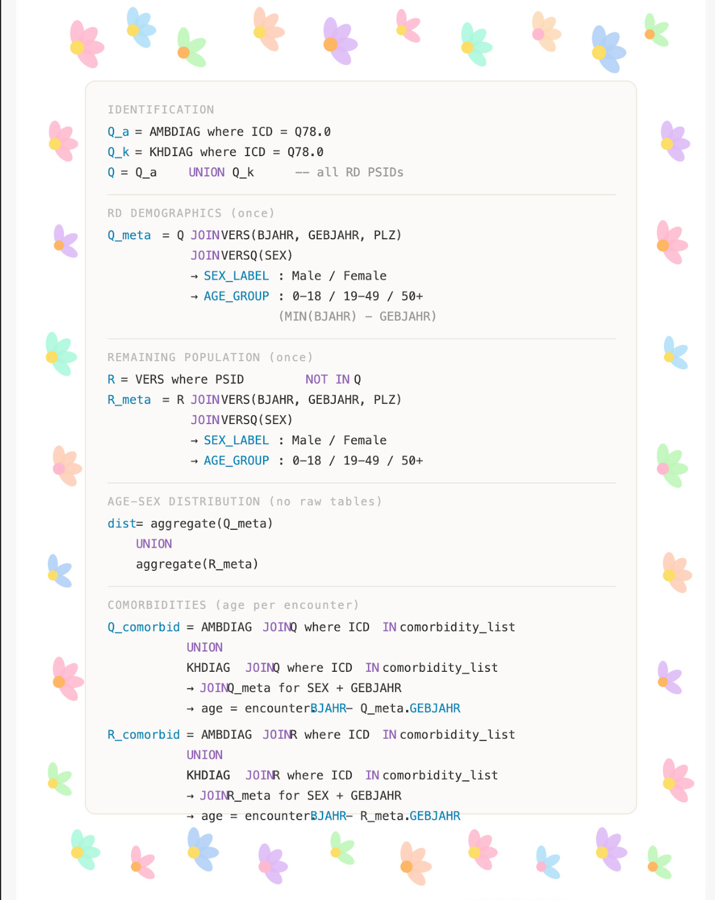

# FDZ-G Claims Data Analysis — Osteogenesis Imperfecta (ICD-10 Q78.0)

A worked example and practical guide for researchers filing an **Antrag** at the Forschungsdatenzentrum Gesundheit (FDZ-G) and running a statutory health insurance (GKV) billing data analysis.

This project analyzes the distribution of Osteogenesis Imperfecta (OI, ICD-10 Q78.0) and its comorbidities in the German GKV population using FDZ-G data. It was developed by [LABRADOR](https://github.com/harisamc/LabValues) as a first step toward rare disease surveillance using routine claims data.

---

## What is FDZ-G and the 1%-PUF?

The **Forschungsdatenzentrum Gesundheit (FDZ-G)** provides researchers with access to routine billing data (Krankenkassendaten) from German statutory health insurance. The data covers the vast majority of the German population and includes diagnoses, procedures, prescriptions, and demographic information.

The **1%-PUF (Public Use File)** is a freely available 1% random sample of the full dataset, intended for:
- Script development and piloting
- Testing analysis logic before the formal Antrag
- Training and teaching

Access to the **full productive dataset** requires a formal application (Antrag) submitted through the FDZ-G portal, including a detailed study protocol, ethical clearance, and a precise description of the intended output tables.

### Data model (Datenmodell 3)

Our analyses are based on four source tables:

| Table | Description | Key columns |
|---|---|---|
| `AMBDIAG` | Outpatient diagnoses | PSID, ICDAMB_CODE, DIAGSICH, BJAHR |
| `KHDIAG` | Inpatient (hospital) diagnoses | PSID, ICDKH_CODE, BJAHR |
| `VERS` | Insurance enrollment | PSID, GEBJAHR, PLZ |
| `VERSQ` | Insurance characteristics | PSID, GESCHLECHT |

---

## The Most Important Step: Design Your Output Tables First

> **Before writing a single line of code**, you must know exactly what your result tables will look like — their columns, their stratification dimensions, and their total number of data cells. Without this, you cannot fill out the Antrag correctly, and you risk designing an analysis that violates the FDZ-G data protection rules.

This was the most challenging part of our OI project, and the reason this documentation exists.

### Constraint 1 — Maximum 2,400 Datenzellen

The entire result set across all output tables combined may contain at most **2,400 data cells** (rows × columns). Per the Nutzerhandbuch für Forschende (p. 16), only the count column (`CNT_D_PSID`) contributes to this limit — not categorical/label columns.

**Cell budget for this project:**

| Table | Description | CNT cells |
|---|---|---|
| TABELLE_ALTER_GESCHLECHT | Age × sex distribution, OI + non-OI | 12 |
| TABELLE_KOMORB_RD | Comorbid ICD codes in OI cohort, by age × sex | ≤ 174 |
| TABELLE_KOMORB_RE | Same codes in remaining population | ≤ 174 |
| TABELLE_PLZ | Geographic distribution by PLZ region × sex | 50 |
| **Total** | | **≤ 410** ✓ |

This leaves comfortable headroom below the 2,400 limit.

### Constraint 2 — Minimum Cell Size: 30 (Sekundärgeheimnis)

Cells with counts between 1 and 29 are **not removed** but **masked as `"1-29"`**. Zero counts remain as 0.

For comorbidity tables, a cascading merge logic applies:
1. Per ICD group, per age group: if both sexes ≥ 30, keep them separate
2. If one sex < 30 in that age group: merge to `Female+Male` for that age group
3. If the merged age group is still < 30: collapse all age groups into a single row (`AGE_ALL`)
4. If even the fully collapsed row is < 30: mask as `"1-29"`

### Constraint 3 — No Marginal Sums (Randsummen)

Total/summary rows and columns are not permitted in result tables. This prevents back-calculation of suppressed cells.

### Lesson from This Project: PLZ Granularity

Our initial design used **5-digit postal codes** for geographic analysis. This produced **8,179 rows** in Table 4 alone — far exceeding the 2,400-cell limit and creating thousands of cells below the MIN_CELL threshold.

**Solution**: Collapse PLZ to its **first digit only** (10 postal regions in Germany). This reduces Table 4 to 10 rows × 5 columns = 50 data cells, well within the constraints.

The takeaway: **granularity that feels natural analytically can be completely infeasible under FDZ-G rules.** Compute your dimensions on paper before filing the Antrag.

---

## Analysis Workflow

The analysis follows a six-step pipeline, illustrated in the pseudocode below:



### Step-by-step

1. **Identify the OI cohort** — scan AMBDIAG and KHDIAG for confirmed Q78.0 diagnoses (`DIAGSICH = 'G'` in AMBDIAG); record earliest diagnosis year per PSID → `V_BASE_ICD`

2. **Annotate with demographics** — retrieve birth year, postal code (VERS), determine sex via majority vote (VERSQ); compute age at first insurance year; exclude Divers/Unbestimmt and unknown ages → `V_META_RD`

3. **Build the remaining (non-OI) cohort** — all PSIDs in VERS not in `V_BASE_ICD`; apply identical demographic filtering → `V_REMAIN_PSIDS`, `V_META_REMAIN`

4. **Age × sex distribution** — `COUNT(DISTINCT PSID)` per age group and sex, for both cohorts → `V_AGE_SEX`

5. **Comorbidity occurrence** — scan AMBDIAG/KHDIAG for target ICD codes; map to grouped categories; count distinct persons per ICD group × sex × age in each cohort → `V_COMO_OI_AGE_SEX`, `V_COMO_RE_AGE_SEX`

6. **PLZ distribution** — first digit of postal code × sex, both cohorts, FULL OUTER JOIN → `V_PLZ_SEX`

---

## Output Tables

### Table I — Age and Sex Distribution (`TABELLE_ALTER_GESCHLECHT`)

| ICD_CODE | ALTERSGRUPPE | GESCHLECHT_LABEL | CNT_D_PSID |
|---|---|---|---|
| Q780 | 0-18 | Female | 5 |
| Q780 | 0-18 | Male | 3 |
| … | … | … | … |
| !Q780 | 50+ | Female | 91119 |

`ICD_CODE = Q780` → OI cohort. `!Q780` → remaining (non-OI) population.

Age groups: `0-18`, `19-49`, `50+`. Unknown/negative ages kept as `Unknown`.

### Table II — Comorbidities in OI Population (`TABELLE_KOMORB_RD`)

Specific ICD-10 diagnoses in Q78.0 patients, stratified by age group and sex. Two query approaches used:

- **Approach 1 — Grouped codes**: all subcategories aggregated to 3-character prefix (e.g., S02.0, S02.1, S02.2 → `S02`). Covers fracture types, musculoskeletal conditions, cardiovascular diagnoses.
- **Approach 2 — Exact codes**: queried as specific diagnoses without grouping (e.g., F480 Neurasthenia, R52 Pain, O80 Spontaneous delivery).

| ICD_GROUP | GESCHLECHT_LABEL | AGE_GROUP | CNT_D_PSID |
|---|---|---|---|
| I10 | Female | 50+ | 15 |
| M54 | Male | 19-49 | 4 |
| … | … | … | … |

### Table III — Comorbidities in Remaining Population (`TABELLE_KOMORB_RE`)

Identical structure to Table II, for all patients without a Q78.0 diagnosis. Used as comparison population.

### Table IV — Geographic Distribution (`TABELLE_PLZ`)

| PLZ | CNT_D_PSID_OI_F | CNT_D_PSID_OI_M | CNT_D_PSID_REMAIN_F | CNT_D_PSID_REMAIN_M |
|---|---|---|---|---|
| 0 | … | … | … | … |
| … | … | … | … | … |
| 9 | … | … | … | … |

PLZ = first digit of postal code (0–9, 10 German postal regions). No `TOTAL` column (Randsumme not permitted).

---

## ICD Coding Nuances

### DIAGSICH — Diagnosis certainty flag (AMBDIAG only)
Only diagnoses with `DIAGSICH = 'G'` (gesichert = confirmed) are included for the index diagnosis. KHDIAG (inpatient) has no DIAGSICH field — all hospital diagnoses are treated as confirmed.

DIAGSICH symbols in KHDIAG (for reference):
- `+` = Kreuz-Code (etiology, cross-star system)
- `#` = Stern-Code (manifestation)
- `-` = no special coding
- `!` = Zusatzcode (supplementary code for primary diagnosis)

### ICD suffixes (G, A, V, Z)
In the **productive dataset**, ICD suffixes (G = gesichert, A = ausgeschlossen, V = Verdacht, Z = Zustand nach) are stripped from the code and placed in a separate `_ZUSATZ` field. In the **1%-PUF**, they may remain attached to the code. The script handles both conventions.

### Sex coding (VERSQ.GESCHLECHT)
| Code | Meaning |
|---|---|
| 1 | Female |
| 2 | Male |
| 3 | Missing (§30 RSAV) |
| 4 | Divers (§22 PStG) |

Sex is determined per PSID by **majority vote** across all VERSQ records. PSIDs with no clear majority (Unbestimmt) or with Divers coding are excluded from the analysis cohorts.

> **PUF note**: Non-1:1 PSID–sex relationships occur more frequently in the 1%-PUF than in the productive data. This is a known PUF artifact and does not affect the productive dataset analysis.

---

## Repository Contents

```
PUF_FDZ/
├── README.md                  # This file
├── main-RD-template.R         # Generic R analysis template (fill in XXXX placeholders)
├── pseudocode_I.png           # Analysis workflow pseudocode
├── oi_fdz_vorschlag2.pdf      # OI project proposal (Vorschlag #2, 2025-12-17)
└── old_scripts/               # Previous project-specific scripts and results
```

### `main-RD-template.R`

A generic, reusable R script template for FDZ-G Datenmodell 3 analyses. Placeholder values (`XXXX`) are used throughout — fill in your project-specific schema name, ICD codes, and descriptions before running.

The script:
- Connects to the FDZ-G analysis environment (Posit Workbench)
- Generates SQL views for the full pipeline (cohort identification → demographics → comorbidities → PLZ)
- Applies cascading small-cell masking (MIN_CELL = 30)
- Exports the four result tables and a data dictionary (Anlage 2 §4.3.3) to the database

---

## Related

- [LABRADOR — Lab Value Analysis for Rare Diseases](https://github.com/harisamc/LabValues)
- [FDZ-G — Forschungsdatenzentrum Gesundheit](https://www.forschungsdatenzentrum-gesundheit.de)
- [Nutzerhandbuch für Forschende](https://www.forschungsdatenzentrum-gesundheit.de/infoportal/nutzerhandbuecher)
